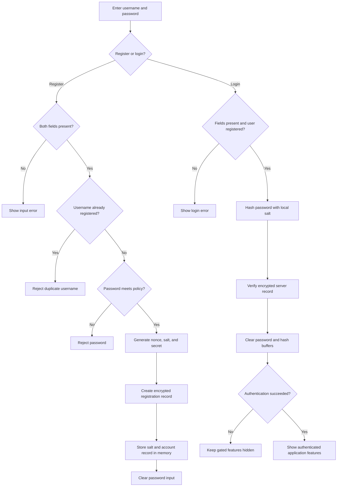
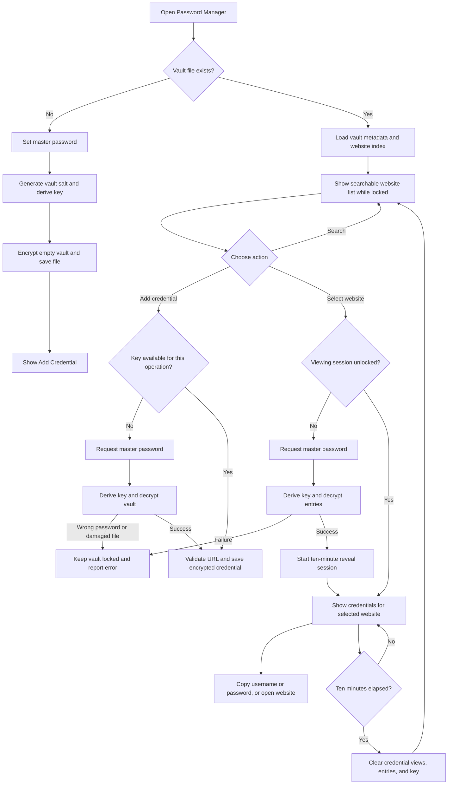
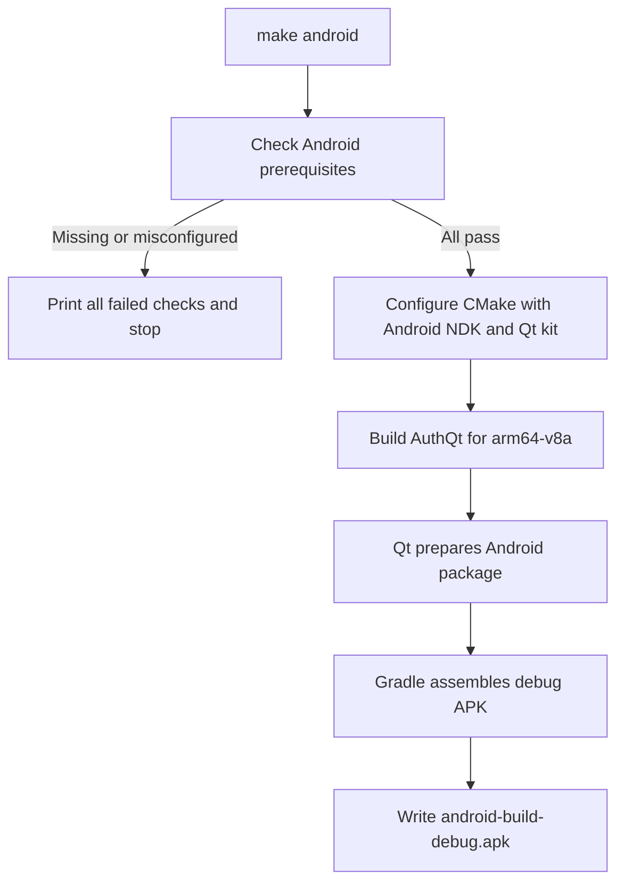
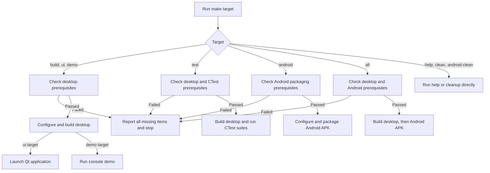

# Auth

[](https://github.com/s-uryansh/Auth/actions/workflows/ci.yml)


Auth is a C++17 Qt application containing an in-memory registration/login demo and a device-local encrypted password vault. Its protocol library uses ML-KEM-768, AES-256-GCM, SHA-256, HMAC, and Argon2id.

After a successful login, the app shows Password Manager and QR Sync. Auth accounts last only for the current run. The vault is stored separately on the device and is not tied to an Auth username.

## Getting started

```bash
git clone --branch AuthV3 --single-branch https://github.com/s-uryansh/Auth.git
cd Auth
make setup
```

`make setup` installs Ubuntu/Debian command-line build packages and OpenJDK 17, bootstraps vcpkg, and installs the desktop manifest dependencies. If Android command-line tools are already installed, it can also install Android SDK platform/build tools and the NDK, and then build the Android vcpkg dependencies. It asks `sdkmanager` to show the Android license prompts; review and accept them yourself.

Qt 6 requires a manual account/download step. At the end of setup, follow the printed instructions to sign in or create a Qt account, download the Qt Online Installer, and install the Qt 6.12.0 Linux desktop GCC 64-bit and Android arm64-v8a kits. Include Core, Gui, Widgets, Qt Svg, and the Android deployment tools. The default kit locations are `$HOME/Qt/6.12.0/gcc_64` and `$HOME/Qt/6.12.0/android_arm64_v8a`; override `QT_HOST_PREFIX` or `QT_ANDROID_PREFIX` if you choose different paths. If `sdkmanager` was not found, install Google's Android command-line tools and follow the SDK/NDK commands printed by `make setup`.

After installing Qt and any remaining Android tools, check readiness with `make preflight-desktop` and `make preflight-android`.

## Make targets

Run these from the project root:

| Command | Purpose |
| --- | --- |
| `make` or `make all` | Build desktop first, then package the Android APK |
| `make build` | Configure and build desktop targets |
| `make test` | Build desktop targets and run the protocol, helper, vault, and storage tests |
| `make ui` | Build and launch the Qt application |
| `make demo` | Build and launch the console demo |
| `make clean` | Remove the desktop build directory |
| `make android` | Configure and package the arm64-v8a debug APK |
| `make android-clean` | Remove the Android build directory |
| `make setup` | Install command-line prerequisites and vcpkg dependencies; print remaining manual setup steps |
| `make preflight-desktop` | Check desktop build prerequisites without building |
| `make preflight-android` | Check Android packaging prerequisites without building |
| `make preflight-test` | Check the CTest runner |
| `make help` | Show available targets |

Build targets check the prerequisites they use before doing work. Desktop targets check the desktop toolchain; Android packaging checks Android toolchain requirements; `make all` checks both and builds sequentially. `make test` checks desktop prerequisites and the test runner. Help and cleanup targets do not require build toolchains. The three `preflight-*` targets can be run directly to inspect a profile without building.

After a successful target finishes, Make verifies its expected build artifacts and prints a visible success message with their paths. `make all` prints a final combined desktop and Android success message with the desktop app, console demo, and APK locations. A failed build, test run, or missing APK does not print a success message.

## Implementation workflows

### Auth registration and login

Accounts are kept in memory for the current app run. Registration validates input and credentials before creating a record. Only a successful login unlocks the gated application features.



Registration passwords need at least eight Unicode code points, an ASCII uppercase letter, an ASCII lowercase letter, a digit, and an ASCII punctuation character.

### Password Manager

The website index remains searchable while the vault is locked. Credential contents are encrypted in the vault file.



### Android APK build

`make android` checks Android packaging prerequisites, configures the arm64-v8a build, and asks Qt and Gradle to produce the debug APK. The default `make` target checks both desktop and Android requirements, then builds desktop followed by Android.



### Make target routing

Each target runs only the prerequisite checks needed for its work. `help` and cleanup targets stay available even when a build toolchain is missing.



## Build requirements

Desktop builds require CMake 3.20 or newer, a C++17 compiler, Git, vcpkg and the manifest dependencies, Qt 6 Core/Gui/Widgets and its Qt Svg CMake dependency, and the host GTest package. Android packaging also needs a Qt Android arm64 kit with those Qt modules, the Qt host deployment tool, a JDK with both `java` and `javac`, an Android NDK, and an SDK with API 30 or newer plus Android build-tools. The Qt kit provides the Gradle wrapper; its user cache must be writable. System-wide Gradle and `adb` are not used by these targets.

`make setup` currently supports Ubuntu and Debian through `apt-get`. It does not install Qt because Qt requires the account-based installer and kit selection described above. Android SDK command-line tools are also a separate Google download; once installed, setup uses `sdkmanager` to install API 35, build-tools 35.0.0, and NDK 27.2.12479018. Android SDK licenses are shown interactively for you to review and accept.

The preflight checks installed paths locally and reports all missing requirements for the selected target with `✗` diagnostics. Install or configure the missing item before retrying. It does not check network availability; vcpkg may need network access when dependencies are first installed.

## Path and tool overrides

The Makefile uses local defaults that can be overridden on the command line or through the environment.

| Variable | Default |
| --- | --- |
| `VCPKG_ROOT` | `$HOME/vcpkg` |
| `TOOLCHAIN` | `$VCPKG_ROOT/scripts/buildsystems/vcpkg.cmake` |
| `VCPKG_INSTALLED_DIR` | `vcpkg_installed/x64-linux` in this checkout |
| `QT_HOST_PREFIX` | `/home/s-uryansh/Qt/6.12.0/gcc_64` |
| `QT_ANDROID_PREFIX` | `/home/s-uryansh/Qt/6.12.0/android_arm64_v8a` |
| `ANDROID_NDK` | `ANDROID_NDK_HOME`, then `ANDROID_NDK_ROOT` |
| `ANDROID_SDK_ROOT` | `$HOME/Android/Sdk` |
| `GRADLE_USER_HOME` | `$HOME/.gradle` |
| `BUILD_DIR` | `build` |
| `ANDROID_BUILD_DIR` | `build_android_arm64` |
| `CMAKE_BIN`, `CXX_BIN`, `CTEST_BIN` | `cmake`, `c++`, `ctest` |

Git and Java are found on `PATH`; Java can also be selected with `JAVA_HOME`. If the default Gradle cache is not writable, set `GRADLE_USER_HOME` to a writable directory. Example: `make android ANDROID_NDK=/path/to/ndk ANDROID_SDK_ROOT=/path/to/sdk`.

## Outputs

- Desktop Qt application: `build/AuthQt`
- Console demo: `build/AuthUI`
- Android debug APK: `build_android_arm64/android-build/build/outputs/apk/debug/android-build-debug.apk`

The Android APK uses arm64-v8a with minimum and target SDK 30. It is a debug package and is not configured for Play Store release signing.
